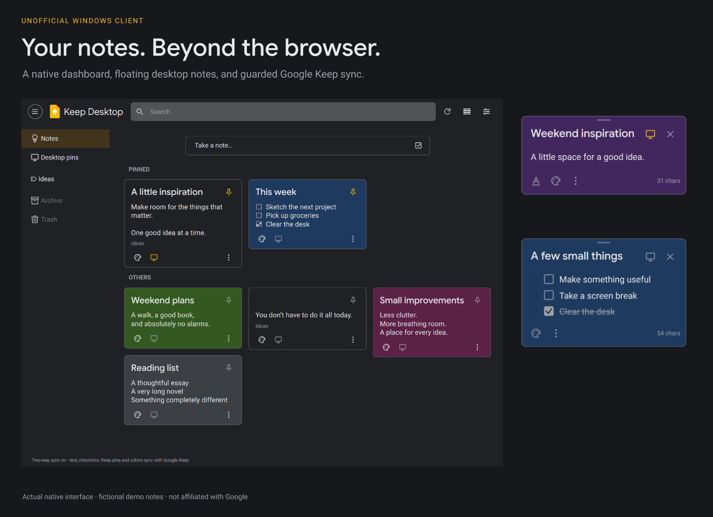
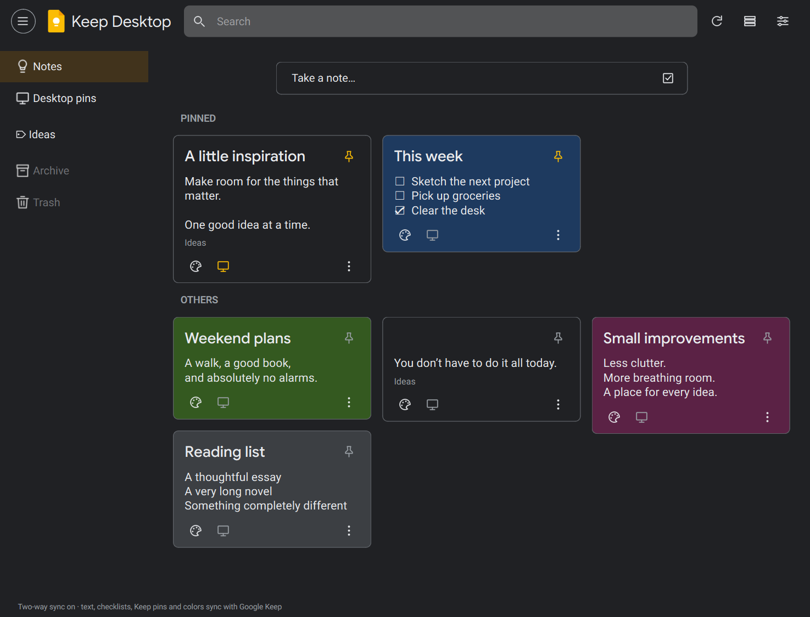
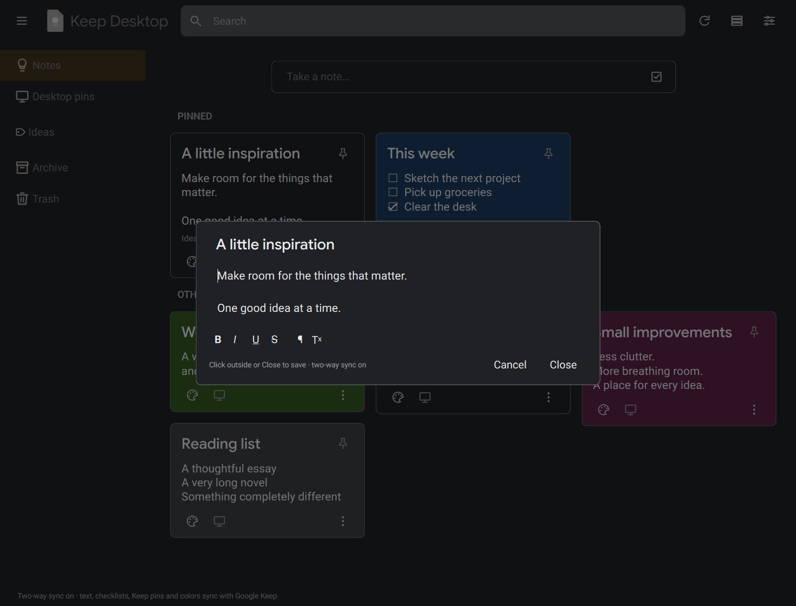
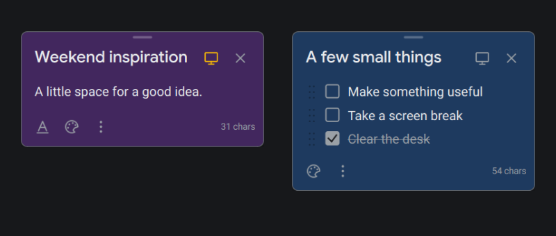

<div align="center">

# Google Keep Notes for Desktop

**The familiar Keep web-style experience, rebuilt as a native Windows app—with floating, pinnable desktop notes.**

[](https://github.com/TylerBuza/Google-Keep-Notes-for-Desktop/releases/latest)
[](https://github.com/TylerBuza/Google-Keep-Notes-for-Desktop/actions/workflows/test.yml)
[](LICENSE)

[Download for Windows](https://github.com/TylerBuza/Google-Keep-Notes-for-Desktop/releases/latest) · [Security](SECURITY.md) · [Release verification](docs/RELEASES.md) · [Issues](https://github.com/TylerBuza/Google-Keep-Notes-for-Desktop/issues)



</div>

> **Unofficial, experimental, and currently unsigned.** Not affiliated with Google.
> Back up important notes before enabling cloud writes. Antivirus results are
> not a security guarantee.

## What it does

- **Native Keep-style dashboard:** searchable masonry cards, grid/list views,
  note colors, and pinned sections—without embedding the Keep website.
- **Web-style editing on desktop:** card-colored in-app editors, click-outside
  saving, Google Sans/Roboto typography, and content-sized layouts.
- **Floating, pinnable notes:** text and checklists on your desktop, remembered
  placement, resizing, local always-on-top, and hide without deleting.
- **Guarded Google Keep sync:** offline edits, explicitly enabled two-way writes,
  conflict handling, encrypted recovery copies, and pauses for uncertain writes.
- **Local security controls:** Windows DPAPI storage, reviewed Google-only runtime
  destinations, blocked note resources/external links, and no automatic updater.

**Thumbtack = Keep pin. Monitor = local desktop visibility/always-on-top.**

<details>
<summary>More native screenshots</summary>





</details>

*All renders use fictional notes and isolated app data; displayed sync state is
fictional, not a personal account capture.*

## Install & connect

**Windows 10/11 x64.** Download the setup EXE and its `.sha256` file from the
[latest release](https://github.com/TylerBuza/Google-Keep-Notes-for-Desktop/releases/latest).
Unresolved antivirus findings are disclosed in the release notes; this is not a
clean-binary claim. Let sync finish, save edits, and **tray → Quit** before upgrading.

Start offline, or use the tray to sign in through Google's visible HTTPS page.
Remembered sign-in stores a powerful token protected for your Windows user.
Cloud writes start **OFF**; enabling them includes **all queued local edits**.
Other software running as your Windows user may access saved credentials.

The internal executable/data-folder name remains `KeepDesktop` for compatibility.
Details: [security and sign-in](SECURITY.md) · [hashes, scans, and builds](docs/RELEASES.md).

## Know the limits

This uses Google's **unofficial internal API**, which can change without notice.
Archive/Trash browsing, label editing, attachments, and reminders aren't
implemented; remote text/checklist conversion is blocked. A WebEngine shutdown
hang remains under investigation. Live cloud-write correctness has not been
comprehensively verified. Keep independent backups; do not disable antivirus
or automatically dismiss detections.

## Run from source

Python 3.13 on Windows:

```powershell
git clone https://github.com/TylerBuza/Google-Keep-Notes-for-Desktop.git
cd Google-Keep-Notes-for-Desktop
python -m venv .venv
.\.venv\Scripts\python.exe -m pip install --require-hashes --only-binary=:all: -r requirements.lock
.\.venv\Scripts\python.exe main.py
```

Offline tests: `python -m pytest tests -q` with `QT_QPA_PLATFORM=offscreen`.
Fictional renders: `python tools/render_project.py --output docs/images`.
Build/publication steps: [docs/RELEASES.md](docs/RELEASES.md).

## Credits

Maintained by [TylerBuza](https://github.com/TylerBuza), based on
[LukeCGG's Keep-Desktop](https://github.com/LukeCGG/Keep-Desktop) and its original
**floating sticky-note and desktop-pinning foundation**.

**We've significantly expanded and redesigned that foundation** to recreate
Keep's web-style browsing and editing in a native desktop dashboard, alongside
the original sticky-note concept, plus substantial authentication, storage, and
sync hardening. This is not a claim of complete Google Keep feature parity or
an entirely from-scratch codebase.

Original credit/history are retained. **[AGPL-3.0](LICENSE)**; see
[CREDITS.md](CREDITS.md) for provenance and font/artwork notices. Google Keep and
its logo are Google's trademarks. **Not endorsed by or affiliated with Google.**
